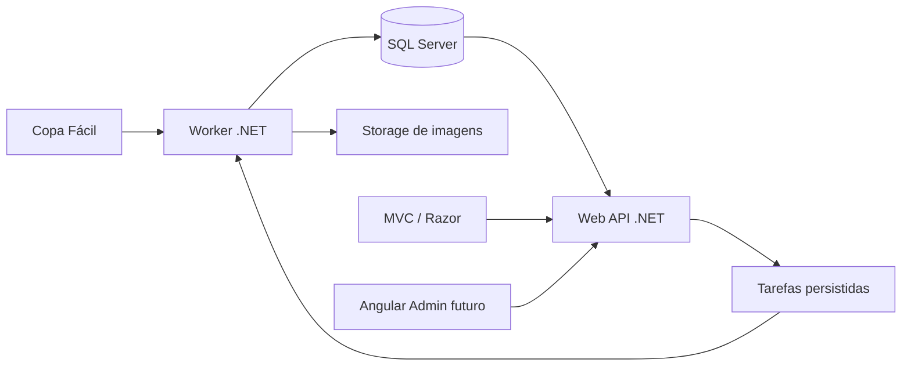

# VIW Funcional Soccer

Plataforma para preservar e apresentar o histórico dos campeonatos de futebol da VIW, reunindo partidas, classificações, jogadores, equipes, técnicos, estatísticas e premiações em um único lugar.

O projeto importa dados do Copa Fácil, mantém uma cópia própria no banco e permite administrar identidades de jogadores e informações oficiais da VIW. O desenvolvimento começa pela ingestão de dados; a interface pública será construída depois, em ASP.NET Core MVC com Razor Views.

## Estado do projeto

O Worker importa as oito edições configuradas, executa ao iniciar e repete a cada hora. Inclui snapshots, checkpoints, atualização idempotente, recuperação de falhas, estatísticas de súmula e armazenamento de fotos local ou R2. Web API e MVC continuam com a estrutura inicial; interfaces de negócio e Admin Angular serão desenvolvidos depois.

O banco é criado e atualizado por migrations explícitas. A execução real da carga e os testes que dependem de SQL Server serão realizados no Windows. Consulte [execução do Worker](docs/worker/running.md) para preparação, comandos, configuração e limitações conhecidas das fontes.

## Objetivos

- Consultar todas as edições em um portal único.
- Preservar campeonatos encerrados sem depender da disponibilidade futura do Copa Fácil.
- Atualizar campeonatos em andamento por meio de importações agendadas.
- Consolidar a carreira de cada jogador entre diferentes copas.
- Manter nomes, IDs e dados originais para conferência e correção.
- Gerenciar premiações, seleções, técnicos, fotos e vínculos de jogadores pelo Admin.
- Disponibilizar páginas públicas com URLs permanentes, conteúdo renderizado no servidor e metadados para busca e compartilhamento.

## Campeonatos iniciais

Os identificadores externos das fontes não serão listados neste README. A documentação apresenta apenas as edições previstas; os vínculos com o Copa Fácil pertencem aos dados de integração.

| Campeonato | Ano | Semestre |
| --- | --- | --- |
| Copa do Nordeste | 2023 | Primeiro |
| Copa do Brasil | 2023 | Segundo |
| Premier League | 2024 | Primeiro |
| EuroViw | 2024 | Segundo |
| LibertaViw | 2025 | Primeiro |
| Campeonato Italiano | 2025 | Segundo |
| Copa do Mundo | 2026 | Primeiro |
| La Liga | 2026 | Segundo |

O cadastro deve separar a competição de suas edições. Novos campeonatos serão cadastráveis, sem alterações no código do importador.

## Stack e arquitetura

- **.NET 10 / C#:** backend e processamento.
- **ASP.NET Core MVC + Razor Views:** portal público, Wiki e acompanhamento autorizado das importações.
- **Angular:** aplicação administrativa futura, consumindo a Web API.
- **ASP.NET Core Web API:** consultas e comandos usados pelo MVC e pelo Admin.
- **Entity Framework Core + SQL Server:** persistência inicial.
- **ASP.NET Core Identity:** autenticação e permissões administrativas.
- **Cloudflare R2:** fotos e escudos, utilizando a franquia gratuita enquanto o consumo permanecer dentro das cotas vigentes.
- **SmarterASP.NET Premium:** hospedagem planejada da aplicação web e do banco.
- **Backend modular com CQRS simples:** comandos e consultas separados logicamente, usando o mesmo banco; Web API e Worker são executores distintos.

As regras de negócio ficam fora de controllers e executores. Importador, Admin e páginas reutilizam os mesmos casos de uso. Não há necessidade inicial de microsserviços, broker de mensagens ou bancos separados para leitura e escrita.

### Estrutura planejada

```text
backend/
  Viw.FuncionalSoccer.slnx
  global.json
  Directory.Build.props
  dotnet-tools.json
  src/
    Viw.Domain/
    Viw.Application/
    Viw.Infrastructure/
    Viw.Contracts/
    Viw.Worker/
    Viw.WebApi/
  tests/
frontend/
  Viw.Mvc/
  viw-admin/              Angular: implementação futura
  tests/
docs/
  architecture/
  decisions/
  integrations/
  worker/
  development/
  operations/
  planning/
```

Os projetos .NET e os testes de fundação foram gerados. A solução do backend está em `backend/Viw.FuncionalSoccer.slnx`, sem incluir o projeto MVC; o Angular permanece reservado. `frontend` inclui o host MVC em C#, pois agrupa as aplicações de apresentação, não apenas arquivos executados no navegador.

- **Worker:** consulta a fonte, persiste dados e processa projeções.
- **Web API:** oferece consultas, comandos administrativos e acompanhamento das importações.
- **MVC:** consome a Web API no servidor e renderiza as copas e a Wiki; pode apresentar o estado do Worker para usuários autorizados.
- **Angular Admin:** consumirá a Web API para administrar jogadores, prêmios, técnicos, seleções e tarefas.
- **Contratos:** DTOs de transporte versionáveis, sem expor entidades do EF Core.

O MVC não acessa o banco diretamente e não hospeda o Worker. As regras de negócio são compartilhadas entre Web API e Worker no backend.

As funcionalidades serão organizadas por módulos: campeonatos, equipes, jogadores, partidas, estatísticas, premiações, mídia, importações e administração.



## Fase 1: Worker de importação

O primeiro componente executável será o Worker. Sua responsabilidade é coletar, validar e persistir dados; ele não depende das telas públicas.

### Fonte e descoberta do contrato

A integração atual da La Liga usa a base:

```text
https://copafacil-web.firebaseio.com/events/{externalChampionshipId}/
```

A inspeção inicial confirmou `info.json`, `matchs.json`, `teams.json` e `player.json`. O recurso de partidas observado na integração atual é `matchs.json`; não presumir `matches.json`. O contrato observado e suas lacunas estão em [Copa Fácil](docs/integrations/copa-facil.md). As demais edições ainda exigem conferência.

O acesso será encapsulado em um adaptador Copa Fácil, com DTOs próprios, timeout, cancelamento, limites de concorrência e retentativas limitadas para falhas transitórias. Não registrar credenciais ou dados sensíveis nos logs.

### Ciclo de uma execução

1. Selecionar a edição habilitada e adquirir uma trava com expiração no banco.
2. Criar um `ImportRun` com identificação, origem, horário e etapa atual.
3. Consultar os recursos necessários e preservar snapshots originais com hash e versão do mapeador.
4. Detectar alterações de conteúdo para evitar reprocessamento desnecessário.
5. Normalizar e validar referências, estados das partidas, datas e placares.
6. Gravar alterações válidas em transações delimitadas, com chaves externas e restrições de unicidade.
7. Registrar eventos pendentes e atualizar as projeções afetadas de maneira idempotente.
8. Persistir checkpoint, contagens, falhas e conclusão; liberar a trava.

### Garantias obrigatórias

- **Idempotência:** executar novamente não duplica partidas, jogadores, gols ou premiações.
- **Rastreabilidade:** registros importados identificam a edição, o ID externo e a revisão de origem.
- **Recuperação:** execuções interrompidas retomam de checkpoints persistidos; progresso não depende apenas de memória.
- **Concorrência:** apenas uma importação por edição; reprocessamento de projeções também deve respeitar exclusão e revisões.
- **Preservação:** fonte indisponível, resposta vazia ou recurso ausente não significa exclusão de dados locais.
- **Validação:** respostas incompletas ou inválidas não substituem o último estado válido. Lotes parciais não podem produzir uma edição aparentemente completa.
- **Correções:** alterações de resultados são versionadas e recalculam somente as projeções afetadas.
- **Decisões manuais:** importações não sobrescrevem vínculos de identidade, prêmios, técnicos, seleções ou fotos oficiais definidos no Admin.
- **Datas:** registrar instantes em UTC; preservar o fuso/contexto da origem e apresentar horários no fuso configurado da edição.

### Campeonatos ativos e encerrados

- Em andamento: política de atualização configurável, mais frequente durante jogos, respeitando a fonte e os limites da execução.
- Encerrados: carga completa, conferência e arquivamento; verificações posteriores menos frequentes ou reimportação manual para correções.
- O encerramento deve considerar o cadastro e os dados válidos, não apenas uma data ou ausência de jogos futuros.
- Cada edição mantém suas regras de pontuação, fases, desempates e premiações. Não aplicar automaticamente as regras da La Liga a todas as copas.

### Execução e hospedagem

O importador será uma biblioteca reutilizável. `Viw.Worker` poderá executá-lo como processo independente; a Web API poderá oferecer um executor de lotes curtos acionado por agendador autenticado, usando os mesmos casos de uso e travas do Worker. O MVC apenas apresenta dados e encaminha solicitações autorizadas à API.

**Não pressupor um Worker permanentemente ativo no IIS compartilhado.** Confirmar no SmarterASP.NET os intervalos mínimos do agendador, os limites de requisição e a possibilidade de processos independentes. O agendamento por URL do Premium é uma opção para tarefas limitadas e retomáveis, não uma garantia de execução contínua.

Se a atualização exigida não couber nesses limites, hospedar o executor fora do IIS. Adicionar Hangfire ou Quartz dentro do site não elimina reciclagens do processo nem substitui uma hospedagem adequada.

### Critérios de aceite do Worker

- Importar uma edição encerrada e a La Liga e conferir totais contra a fonte.
- Repetir a importação sem criar duplicações.
- Processar uma correção de resultado e reconstruir as estatísticas correspondentes.
- Interromper e retomar uma execução sem perda ou duplicação.
- Impedir importações concorrentes da mesma edição.
- Preservar o estado anterior diante de timeout, erro ou resposta incompleta.
- Demonstrar que dados oficiais manuais não são sobrescritos.
- Produzir um resumo com recursos lidos, registros incluídos/alterados, rejeições e duração.

## Identidade única dos jogadores

Um jogador pode aparecer como “Leo”, “Leo Reis” ou “Reis” em edições diferentes. O modelo separa:

- `Player`: pessoa única reconhecida pela VIW, com ID interno estável.
- `SourcePlayer`: cadastro original de uma edição, com nome e ID preservados.
- `PlayerRegistration`: participação em uma equipe/edição, permitindo transferências e períodos de atuação.
- Vínculo de identidade: associação auditada e reversível entre cadastro de origem e pessoa.

A chave externa é composta por provedor, edição e identificador do recurso; nomes não são chaves de identidade. Similaridade pode gerar sugestões, mas não autoriza união automática.

O Admin permitirá comparar registros, confirmar vínculos, desfazer associações e escolher nome e foto oficiais. Unir jogadores não apaga os fatos originais. As estatísticas consolidadas são recalculadas a partir dos vínculos vigentes, sem contar participações duplicadas.

Equipes também pertencem inicialmente à edição: nomes iguais em copas diferentes não bastam para unificá-las.

## Premiações, técnicos e informações oficiais

Todos os itens abaixo serão persistidos e editáveis no Admin:

| Informação | Escopo |
| --- | --- |
| Prêmio de artilheiro | Edição, permitindo múltiplos vencedores |
| Ballon d’Or / melhor do campeonato | Edição |
| Craque da partida | Partida |
| Técnico | Equipe e rodada/período de atuação |
| Seleção e técnico da rodada | Rodada |
| Seleção do campeonato | Edição |
| Outras premiações | Categoria e escopo configuráveis |

Separar **liderança calculada da artilharia** de **premiação oficial confirmada**. Correções na fonte podem sinalizar divergências, mas não substituem silenciosamente uma decisão confirmada.

Premiações terão categoria, edição/partida, premiado, situação (rascunho ou confirmado), observações e auditoria. Técnicos terão histórico por rodada/período; trocar o técnico atual não altera os responsáveis pelas rodadas anteriores.

## Persistência, CQRS e eventos

Entidades principais previstas:

- `Competition`, `ChampionshipEdition`, `RuleSet` e `TeamEntry`.
- `Player`, `SourcePlayer`, `PlayerRegistration` e vínculos de identidade.
- `Match` e `PlayerMatchStatistics`.
- `AwardDefinition`, `AwardGrant`, seleções e `CoachAssignment`.
- `MediaAsset`, `ImportRun`, `SourceSnapshot` e checkpoints.
- `AuditEntry`, `OutboxMessage` e projeções de estatísticas.

Comandos alteram dados; consultas retornam modelos preparados para a interface. Inicialmente ambos usam SQL Server. Projeções de classificação, artilharia e carreira devem ser reconstruíveis a partir dos fatos normalizados, regras versionadas e decisões administrativas.

Eventos como `MatchResultChanged`, `PlayerIdentityLinked`, `PlayerIdentityUnlinked` e `ManualAwardAssigned` podem disparar atualizações. A **Outbox** grava alterações e mensagens na mesma transação; o consumidor tolera entregas repetidas.

**Event Sourcing completo não faz parte do escopo inicial.** Snapshots e auditoria preservam histórico, mas não são apresentados como um event store capaz de reconstruir sozinho todo o domínio. A adoção desse padrão exigirá uma decisão arquitetural específica.

## Imagens e arquivos

- Armazenar fotos e escudos em storage de objetos; manter metadados e referências no banco.
- Deduplicar arquivos por hash e gerar versões adequadas à exibição.
- Preservar origem, tipo, tamanho e histórico das substituições oficiais.
- Validar conteúdo, tamanho e destinos permitidos ao baixar arquivos externos.
- Evitar depender de links temporários do Copa Fácil para o acervo histórico.
- Proteger cópias brutas que contenham dados não públicos; não expor todos os snapshots no domínio de mídia.
- Acompanhar consumo: franquia gratuita não significa armazenamento ilimitado ou ausência de cobrança por excedentes.

## Fase 2: MVC, Wiki e Admin

Rotas públicas planejadas:

```text
/campeonatos
/campeonatos/la-liga-2026-2
/campeonatos/la-liga-2026-2/classificacao
/campeonatos/la-liga-2026-2/jogos
/campeonatos/la-liga-2026-2/artilharia
/campeonatos/la-liga-2026-2/premiacoes
/wiki/jogadores/leo-reis-a81f
/wiki/campeonatos/copa-do-mundo-2026-1
/admin
```

O domínio planejado é `viwfuncionalsoccer.com.br`. URLs de edições permanecem estáveis; aliases curtos podem redirecionar para uma edição. Mudanças de nomes e unificações de perfis preservam links antigos com redirecionamento permanente.

As páginas terão HTML renderizado no servidor, títulos e descrições próprios, canonical, metadados de compartilhamento, sitemap XML, navegação por links e respostas HTTP corretas. O Admin Angular exige autenticação e permissões verificadas pela Web API; não deve ser indexado. Formulários MVC e endpoints autenticados por cookies exigem proteção contra CSRF. A estratégia de autenticação entre as aplicações está descrita na documentação.

A Wiki exibirá participações, equipes, jogos, gols e prêmios, distinguindo informações indisponíveis de valores realmente iguais a zero. Atualizações de placar podem usar JavaScript pontual, sem transformar o portal em uma SPA.

## Desenvolvimento local: preparação

Pré-requisitos previstos:

- SDK .NET 10.
- SQL Server acessível e banco exclusivo de desenvolvimento.
- IDE de preferência e Git.
- Credenciais de storage quando a etapa de imagens for habilitada.

Em macOS, o SQL Server pode ser remoto ou executado em um ambiente compatível. Não presumir disponibilidade nativa de SQL Server em Apple Silicon.

O SDK está fixado em `backend/global.json` e `frontend/global.json`; `.env.example` documenta configuração local sem segredos. Os comandos de execução estão em [desenvolvimento local](docs/development/getting-started.md). Banco e alterações de esquema usam [migrations EF Core](docs/development/database.md).

Configurações planejadas incluem conexão de banco, base URL do provedor, edições habilitadas, timeouts, intervalos, tamanho de lote e storage. Segredos devem usar User Secrets no desenvolvimento e configuração segura no ambiente publicado; nunca ser versionados.

Os testes iniciais focarão idempotência, mapeamento de fontes, identidade, correções, regras por edição, recuperação e concorrência. Usar amostras sanitizadas e testes de integração em banco isolado, sem depender da fonte pública em todos os testes.

## Publicação e operação

- Validar testes e compilação antes de publicar.
- Gerar pacotes distintos para MVC, Web API e Worker; o Angular terá pacote estático quando implementado.
- Aplicar migrações de maneira controlada, com backup e compatibilidade entre versões.
- Configurar HTTPS, domínio, banco, segredos e agendamento.
- Verificar saúde da aplicação e último sucesso de importação por edição.
- Manter logs estruturados com IDs de execução, sem segredos.
- Monitorar falhas repetidas, atrasos na sincronização, armazenamento e backups.
- Não tratar “site respondendo” como prova de que as importações estão saudáveis.

## Ordem de implementação

1. Criar solução .NET, contratos, configuração e modelo inicial do banco.
2. Inspecionar os recursos de uma copa encerrada e da La Liga; documentar os mapeamentos.
3. Implementar carga, snapshots, validação, idempotência e checkpoints.
4. Implementar estatísticas básicas e testes de correção/recuperação.
5. Adicionar importação de imagens e políticas de atualização.
6. Importar e conferir as demais edições.
7. Expor consultas e comandos na Web API; construir posteriormente o Admin Angular e os cadastros oficiais.
8. Construir portal MVC e Wiki.
9. Preparar SEO, operação e publicação no SmarterASP.NET.

## Documentação do projeto

Consulte o [índice de documentação](docs/README.md) para arquitetura, decisões, contratos de integração, Worker, desenvolvimento, operação e roadmap.

## Referências

- [ASP.NET Core](https://learn.microsoft.com/aspnet/core/)
- [Worker Services](https://learn.microsoft.com/dotnet/core/extensions/workers)
- [Entity Framework Core](https://learn.microsoft.com/ef/core/)
- [CQRS](https://learn.microsoft.com/azure/architecture/patterns/cqrs)
- [Event Sourcing](https://learn.microsoft.com/azure/architecture/patterns/event-sourcing)
- [SmarterASP.NET: planos](https://www.smarterasp.net/hosting_plans)
- [SmarterASP.NET: tarefas agendadas](https://www.smarterasp.net/support/kb/a2385/how-to-schedule-a-task.aspx)
- [Cloudflare R2: preços e franquias](https://developers.cloudflare.com/r2/pricing/)

## Licença

Consulte [LICENSE](LICENSE). A licença do código não substitui a verificação de permissões de uso e publicação dos dados e imagens importados.
