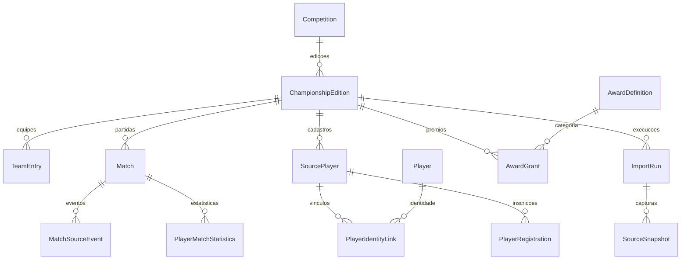

# Modelo inicial do banco

Etapa 3: modelo EF Core para SQL Server, schema `viw`, com migration `CreateCompetitionModel` após a baseline `InitialCreate`. Nenhum dado real foi importado e nenhuma migration é aplicada automaticamente ao iniciar os hosts.

## Tabelas

| Grupo | Entidades | Finalidade |
| --- | --- | --- |
| Competição | Competition, ChampionshipEdition, EditionSource, RuleSet | Competição, edição, vínculo de origem e versões das regras |
| Calendário | CompetitionPhase, CompetitionRound, TeamEntry, Match | Fases, rodadas, equipes da edição, referências futuras e placar |
| Pessoas | Player, SourcePlayer, PlayerIdentityLink, PlayerRegistration | Identidade canônica, nome original, vínculos reversíveis e equipes por período |
| Estatística | MatchSourceEvent, PlayerMatchStatistics | Eventos recebidos e fatos normalizados por jogador/partida |
| Organização | Coach, CoachAssignment, AwardDefinition, AwardGrant | Técnicos por período/rodada e decisões oficiais de premiação |
| Arquivos | MediaAsset | Hash, armazenamento, tamanho, origem e visibilidade |
| Importação | ImportRun, SourceSnapshot, ImportCheckpoint, ImportLease | Execuções, conteúdo original, progresso e exclusão mútua |
| Histórico | AuditEntry, OutboxMessage | Alterações administrativas e mensagens transacionais |

Todas têm ID interno GUID gerado pela aplicação, criação em UTC e rowversion para concorrência otimista. IDs externos são texto, indexados com comparação binária para não confundir maiúsculas. O nome de uma pessoa nunca é chave de identificação.

## Integridade garantida pelo banco

- Slugs únicos; edição com ano e semestre válidos.
- Origem única por provedor/ID e um vínculo de cada provedor por edição.
- Equipe, jogador e partida únicos por edição/provedor/ID.
- Chaves estrangeiras compostas impedem usar equipes ou cadastros de outra edição em uma partida/registro.
- Equipes iguais não podem se enfrentar; placares não são negativos; jogo encerrado exige dois participantes e placares normalizados.
- Rodada de uma partida pertence à mesma fase/edição.
- Um único vínculo ativo por cadastro de jogador; vínculos encerrados permanecem no histórico.
- Estatística única por jogador de origem e partida; valores desconhecidos continuam nulos.
- Um premiado é jogador OU técnico. Empate permite múltiplos jogadores no mesmo prêmio; duplicação da mesma concessão ativa é impedida.
- Seleções podem usar categorias de premiação por rodada/edição e `Position` para a posição ocupada.
- Snapshot armazena JSON válido OU chave de storage privado; hash único por edição/recurso evita repetir conteúdo.
- Um lease por edição, com proprietário, geração e expiração. Rowversion ajuda a impedir gravações concorrentes.
- Exclusões em cascata são desabilitadas: apagar uma pessoa/edição não pode apagar seu histórico silenciosamente.

## Regras para os casos de uso futuros

Nem toda regra entre tabelas cabe em CHECK: o Worker/Admin deverão confirmar que a equipe de uma estatística participa da partida; o premiado corresponde ao tipo da categoria; a concessão corresponde ao escopo campeonato/rodada/partida; períodos de inscrição/técnico não conflitam indevidamente. Devem ainda verificar propriedade do lease em cada gravação, permissões, auditoria e reversão de identidades.

A separação entre dados originais e decisões manuais é estrutural; a proteção contra sobrescrita será exercida pelos casos de uso na etapa do Worker. Não há importador ou endpoints administrativos implementados agora.

Agregados textuais e campos desconhecidos permanecem nos snapshots até seu mapeamento validado. Não tratar dados acumulados como presença por partida. Projeções de classificação e carreira serão implementadas após a ingestão; não há tabelas de resultados calculados alimentadas nesta entrega.

## Relacionamentos principais

## Validação

Testes locais validam metadados EF, SQL idempotente, chaves compostas, comparação binária, filtro de vínculo ativo e alinhamento do snapshot com o modelo. Teste separado aplica migrations em um banco SQL Server temporário com nome aleatório, verifica unicidade, escopo de equipes, resultado final, reversão de vínculo e empate na artilharia.

O teste real exige `ConnectionStrings__ViwTestServer`; sem essa variável aparece explicitamente como ignorado. A CI foi configurada com SQL Server em serviço isolado. Docker local está parado nesta entrega: aplicação real das migrations e teste contra SQL Server ainda não foram executados localmente.

## Organização dos mapeamentos

`Persistence/Configurations` contém uma classe `IEntityTypeConfiguration<T>` para cada entidade. Cada classe define seus relacionamentos, índices, restrições e propriedades. `EntityConfiguration` compartilha apenas a configuração de ID, tabela e rowversion. `ViwDbContext` registra as classes por `ApplyConfigurationsFromAssembly`. A separação mantém o modelo e as migrations existentes, sem criar alteração de esquema.

## Convenções globais de colunas

`ViwDbContext.ConfigureConventions` define texto Unicode de até 100 caracteres (`nvarchar(100)`), decimal com precisão 18 e escala 4, e datas `datetimeoffset` preservando instante/offset. As configurações individuais prevalecem sobre esses padrões.

Nomes, slugs e alguns campos administrativos continuam com 200 caracteres; referências externas mantêm seus limites próprios; URLs aceitam 2048; chaves de storage, 400 quando configuradas. JSON permanece `nvarchar(max)`, sem o limite de 100, e hashes continuam `varchar(64)` por serem ASCII. Nenhuma configuração converte automaticamente datas locais para UTC: essa responsabilidade permanece nos casos de uso.

A migration `ApplyDefaultColumnConventions` registra a redução dos campos curtos antes configurados como 200. Não altera nem trunca valores de registros; caso já exista banco com conteúdo maior que o novo limite, conferir e corrigir esses dados antes de aplicar. A migration não foi aplicada a um servidor nesta entrega.
